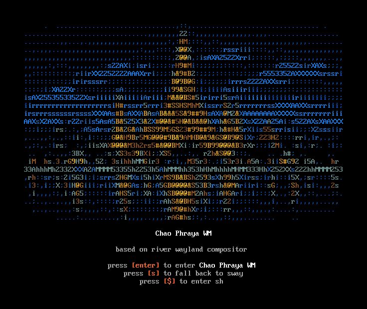

# Chao Phraya WM

A sway-like tiling window manager for the [river](https://codeberg.org/river/river)
Wayland compositor (0.5 and newer), written in Rust.

**NOTE.** I wrote this WM (with the help of Claude) only to serve my needs. It was developed based on my use case of Sway WM with some extras that Sway WM would not allow. I strictly refrain from all animations and eye candies.

River 0.5 is a compositor only: window management is done by a separate client
speaking `river-window-management-v1`. chaophraya is that client.

<p align="center">
  
</p>
<p align="center"><em>The session selector after login on the Linux console: <code>[enter]</code> starts
Chao Phraya WM, <code>[s]</code> falls back to sway, <code>[$]</code> opens a shell.</em></p>

## Features

- **Sway-style tiling tree**: a lone window splits left/right; after that a new
  window splits the focused one top/bottom (or joins its container). `splith`,
  `splitv`, `layout toggle split`.
- **Stacking and tabbed layouts with title bars**, drawn by the WM. Click a tab to
  switch to it.
- **Workspaces 1–10 that behave like sway's**, with per-workspace focus memory,
  multi-monitor support and workspace-to-output assignment.
- **Sticky tiled windows**: a sticky window follows you to every workspace and
  always sits in the same slot (bottom of the right-most column).
- Floating windows, scratchpad, fullscreen, window rules (floating, sticky,
  workspace, size, border width, kill, scratchpad, inhibit_idle).
- **Multi-monitor**: the cursor follows keyboard focus to another output
  (`mouse_warping`, like sway's); workspace pinning and moving between outputs; an output
  placed exactly on top of another (same position and size) is treated as a
  mirror, which is how mirroring works on river;
  `park_outputs_except` keeps external monitors parked (on, but unused)
  until you choose a layout. Parking instead of switching them off matters on
  river: some monitors reconnect when their signal stops, and river switches
  a reconnected output back on, which turns "off" into an endless flicker.
- Mouse: `Super`+left-drag moves floating windows; `Super`+right-drag resizes
  floating windows, or moves the split edge nearest the cursor on tiled ones.
- **Combined views**: show other workspaces beside the current one, each in
  its own region with its own tree (river-classic's tags, without giving up the
  tree), and sway-style **binding modes** to drive them from the keyboard.
- Keyboard layouts (xkb, e.g. `us,th`), repeat rate and libinput settings
  (touchpad tap, natural scroll, acceleration, ...).
- Key bindings that keep working on any keyboard layout; `locked:` bindings that
  stay active on the lock screen (media keys).
- **IPC**: `chaophraya msg <command>`, JSON state streaming for status bars, and
  a `chaophraya waybar` subcommand that feeds waybar custom modules.

chaophraya is only the window manager: no bar, lock screen or helper scripts
are included. [Integration](#integration) shows how to connect them.

## Repository layout

| Path | What it is |
|---|---|
| `crates/chaophraya` | The window manager and its command-line client (one binary) |
| `crates/chaophraya-tree` | The tiling tree: pure Rust, no Wayland, unit tested |
| `crates/chaophraya/default-config.toml` | The built-in default config (also a template for your own) |
| `crates/chaophraya/protocol/` | river's protocol XML files the bindings are generated from |
| `man/` | Manual pages in scdoc format: `chaophraya(1)` and the config file, `chaophraya(5)` |

## Requirements

- **river 0.5 or newer** (Arch: `river`; note it conflicts with `river-classic`)
- **Rust** (stable, with cargo) to build
- At runtime: a font for title bars (`noto-fonts` by default; configurable) and
  `libnotify` (`notify-send`, used to report failed reloads).

## Build and install

```sh
cargo build --release                 # build everything
cargo test                            # run the unit tests
cargo install --locked --path crates/chaophraya --root ~/.local
```

This installs a single binary, `~/.local/bin/chaophraya`. Make sure
`~/.local/bin` is on the `PATH` of your session.

The manual pages need [scdoc](https://git.sr.ht/~sircmpwn/scdoc)
(`pacman -S scdoc`):

```sh
mkdir -p ~/.local/share/man/man1 ~/.local/share/man/man5
scdoc < man/chaophraya.1.scd > ~/.local/share/man/man1/chaophraya.1
scdoc < man/chaophraya.5.scd > ~/.local/share/man/man5/chaophraya.5
man chaophraya          # the program, its commands and IPC
man 5 chaophraya        # the config file
```

## Getting started

### 1. Start a session

River runs the window manager given with `-c`:

```sh
river -c chaophraya
```

Run it from a TTY, or from your greeter (e.g. greetd + tuigreet:
`command = "tuigreet --cmd 'river -c chaophraya'"`). Always pass `-c`: without
it, river 0.5 runs `~/.config/river/init`, which may be an old river-classic
init. Set `XDG_CURRENT_DESKTOP=river` in the session's environment for desktop
portals.

To keep a log of errors (and of the programs chaophraya starts):

```sh
mkdir -p ~/.local/state/chaophraya
river -c 'exec chaophraya 2>>~/.local/state/chaophraya/chaophraya.log'
```

If the screen ever freezes, chaophraya has probably stopped while river kept
running: check the log from another TTY, then `pkill river` to get back to the
login screen.

The session selector pictured at the top isn't part of this repository.

### 2. Config

```sh
mkdir -p ~/.config/chaophraya
cp crates/chaophraya/default-config.toml ~/.config/chaophraya/config.toml
chaophraya check-config               # reports mistakes with line numbers
```

Without a config file the built-in default is used. Edit and press
`Super+Shift+r` (or run `chaophraya msg reload`) to reload; a failed reload keeps
the running config and reports the error (as a notification when triggered by a
key, printed when run with `chaophraya msg`). A new chaophraya
*binary* needs a session restart.

The config has these sections: `[general]` (borders, gaps, font, title format,
focus follows mouse, mouse warping, floating modifier), `[colors]`, `[keyboard]` (xkb layout,
options, repeat), `[[input]]` (libinput settings per device), `[bindings]`,
`[[rules]]`, `[workspace_outputs]` and `[autostart]` (`exec` once,
`exec_always` on every reload). The default config shows all of them except
`[workspace_outputs]`, which is optional and empty by default. It pins
workspaces to an output by name, like sway's `workspace N output NAME`:

```toml
[workspace_outputs]
"1" = "eDP-1"        # example: workspace 1 opens on the laptop screen
```

Switching to a pinned workspace that isn't visible opens it on that output (or
on the current one if that output is off or unplugged); a workspace that is
already visible is just focused where it is. Unpinned workspaces open on the
output you're on.

## Integration

chaophraya ships no scripts; other programs talk to it through
`chaophraya msg` and its JSON state (see `man chaophraya`). Some common setups:

**Status bar.** waybar's `sway/*` and `river/*` modules don't work with
chaophraya; use custom modules fed by `chaophraya waybar`, which streams JSON
lines, so they update instantly:

```jsonc
"custom/ws1": {
  "exec": "chaophraya waybar workspace 1",   // also: title, layout, keyboard, mode
  "return-type": "json",
  "on-click": "chaophraya msg workspace 1"
}
```

A workspace module gets the class `focused`, `visible`, `urgent` or `occupied`,
and hides itself while the workspace is empty. Other bars can read
`chaophraya subscribe` directly.

**Idle and lock.** River ignores idle inhibitors from the window manager, so an
`inhibit_idle` rule shows up as `"idle_inhibited": true` in the state instead;
let the lock command check it:

```toml
[autostart]
exec_always = [
  "pkill -x swayidle; exec swayidle -w timeout 300 'chaophraya msg get_state | grep -q \"\\\"idle_inhibited\\\":true\" || swaylock -f' before-sleep 'swaylock -f'",
]

[[rules]]
app_id = "firefox|Chromium|chromium"
inhibit_idle = "fullscreen"          # or visible, focus, open
```

**Urgent windows.** River doesn't tell the window manager when a window wants
attention. Anything that knows can say so: `chaophraya msg urgent app_id
<app_id>` marks that app's hidden windows urgent until they are focused (urgent
border colour, `urgent` class in the bar). Useful hooks are a notification
daemon's per-notification script (dunst: `script` in a rule) and a wrapper set
as the default browser that runs it before opening the link.

**External monitors.** Arrange outputs with `wlr-randr` (or any
wlr-output-management tool). With `park_outputs_except = ["eDP-1"]` other
monitors start parked; use one with e.g.

```sh
wlr-randr --output HDMI-A-1 --on --pos 1920,0 && chaophraya msg output HDMI-A-1 unpark
```

Placing an output exactly over another (same position and size) mirrors it.

## Usage

### Commands

Key bindings and `chaophraya msg` use the same, sway-flavoured commands:

| Command | Effect |
|---|---|
| `spawn <cmd>` / `exec <cmd>` | Run a shell command |
| `kill` | Close the focused window |
| `focus left\|right\|up\|down` | Move focus (crosses to the next output at the edge) |
| `focus mode_toggle` | Switch between tiled and floating windows |
| `focus id <n>` | Focus a window by id (see `get_windows`) |
| `move left\|right\|up\|down` | Move the focused window (to the next output at the edge) |
| `workspace <n>` | Show workspace 1–10 |
| `workspace <n> output <name>` | Open workspace n on that output from now on (overrides `[workspace_outputs]`) |
| `move workspace to output <name>` | Move the focused workspace to that output |
| `output <name> park\|unpark` | Park an output (stays on, no workspace, skipped by focus) or use it again |
| `move to workspace <n>` | Send the focused window there |
| `splith`, `splitv` | Next window opens beside / below |
| `layout splith\|splitv\|stacking\|tabbed` | Layout of the focused window's container |
| `layout toggle split` | Swap split direction / leave stacking or tabbed |
| `resize grow\|shrink width\|height <n> px` | Resize the focused window |
| `fullscreen`, `floating toggle`, `sticky toggle` | Toggle window states |
| `view toggle <n>\|all` | Show workspace n (or every workspace with windows) beside the current one, river-classic style; again to hide it. `workspace <n>` ends the combined view |
| `scratchpad show all` | Show every hidden scratchpad window (again: hide them all) |
| `mode <name>` | Switch binding mode: a `[modes.<name>]` table, or `default` |
| `move scratchpad`, `scratchpad show` | Scratchpad, like sway: `show` brings a hidden window to the current workspace (or one shown elsewhere), hides it again if it's focused, and cycles through several |
| `keyboard layout <n>\|next` | Switch keyboard layout |
| `urgent app_id <name>` | Mark an app's hidden windows urgent |
| `reload`, `exit` | Reload the config / end the session |

### Command-line client

```sh
chaophraya msg workspace 3            # run a command
chaophraya msg get_state              # JSON: workspaces, focused window, layout, keyboard layout
chaophraya msg get_windows            # JSON: all windows with id, title, app_id, workspace, rect
chaophraya subscribe                  # JSON state line on every change
chaophraya waybar workspace 3         # waybar JSON for workspace 3 (also: title, layout, keyboard, mode)
chaophraya check-config               # validate ~/.config/chaophraya/config.toml
```

The socket is `$XDG_RUNTIME_DIR/chaophraya.$WAYLAND_DISPLAY.sock`; everything
started from the session also gets it as `$CHAOPHRAYA_SOCK`.

## Limitations

These come from river 0.5's protocols, not from chaophraya:

- **No urgency events**: river handles xdg-activation itself; see
  [Integration](#integration) for `urgent app_id`.
- **No scroll-wheel bindings**: river's pointer bindings are buttons only, so
  sway's `Super+scroll` resize isn't possible; use `Super+right-drag`.
- **The WM can't hold idle inhibitors** (river ignores them on WM surfaces), hence
  `idle_inhibited` in the state. Apps that inhibit idle themselves (video
  players, browsers playing video) work normally.

## Development

The tiling logic lives in `chaophraya-tree` and is covered by unit tests,
including a randomised test of 5000 operations. Everything else can be tested
in a headless river with no window on your screen:

```sh
WLR_BACKENDS=headless WLR_RENDERER=pixman WLR_HEADLESS_OUTPUTS=1 \
  river -c "sh my-test-script.sh"
```

Inside the script, start `target/debug/chaophraya`, open clients, drive it with
`chaophraya msg ...` (or `wtype` for real key presses) and take screenshots with
`grim`.

**Careful when you test from inside a chaophraya session:** your environment's
`$CHAOPHRAYA_SOCK` points at the *real* window manager, so `chaophraya msg exit`
in a test would end your session. Run tests with `env -u CHAOPHRAYA_SOCK ...`.

## License

MIT, see [LICENSE](LICENSE). The protocol files in `crates/*/protocol/` are
river's, under their own (MIT) licence headers.
